<!-- fork-notice:start -->
<p align="center">
  
</p>

# SayItLocally

> [!IMPORTANT]
> **SayItLocally 是 [crosswk/SayIt](https://github.com/crosswk/SayIt) 的個人自用 fork，目標是「透過說話，把開發者自己重要的文字記錄下來，驗證過去，指引未來；只用本機辨識，語音、文字與使用資訊都不外流」。** 原名 SayIt，2026-11-19 10:50 更名；上游的名稱、網址、授權與著作權聲明皆保留。
>
> - 基準版本：上游 commit `4fdeae9`（2026-11-09），client `0.2.5`；本 fork 版本 `0.1.0`（第一個自建版本）
> - 只保留 **Local 模式**（Server、Cloud API 入口已移除）；**AI 校對預設關閉**；**歷史記錄與錄音預設不保存**
> - 已停用：啟動公告、自動更新（檢查、下載、結束時安裝）、Google Fonts、意見回饋／診斷／ASR 校正上傳；CSP 已收緊
> - 嚴禁 DeepSeek；日後 AI 校對只考慮本機 Ollama
> - 介面與文件只用正體中文（台灣）。上游的簡體中文說明、供應商教學，以及畫面含簡體或 DeepSeek 的截圖已移除；下方上游說明中與「只用本機」矛盾的敘述以「本 fork」註記更正
> - 不使用官方安裝檔，一律從原始碼自行建置：App 名稱 `SayItLocally.app`，bundle ID `com.sayitlocally.desktop`
>
> 外流風險的完整登錄、處理方式與進度見 **[`security/`](security/README.md)**。
>
> ⚠️ 所有修改**尚未實際執行、尚未斷網實測、尚未抓封包驗證**。
>
> 依 AGPL-3.0 第 5 條聲明：本 fork 自 2026-11-19 起修改上游程式碼，修改處以 `[自訂]` 註解標示，完整變更見 git 歷史。
<!-- fork-notice:end -->

---

> 以下為**上游 SayIt 的原始說明**，保留供參考。其中的官方安裝檔下載連結**不適用於本 fork**，請勿使用。
>
> ⚠️ **使用前請注意（S54、S53）**：
> - 下方的「Download」、release 徽章連到**上游官方安裝檔**，不含本 fork 的任何強化（會連上游伺服器、公告、更新等）。
> - 「Try the web demo」（`sayitapp.site`）是**上游的線上服務**，會把你的語音上傳到對方伺服器辨識，與本 fork「語音不離開本機」的目標相反。
> - 倉庫中的 `v0.2.5` 標籤是**上游原版**，不是本 fork 的強化版。本 fork 自 2026-11-21 起版本號為 `0.2.6`，2026-11-27 起改為 `0.1.0`（第一個自建版本，標籤屆時為 `v0.1.0`）；既有的 `v0.2.6-local.1` 標籤只是原始碼快照。版本號與上游的同號版本無關，請以 `hardening/local-only` 分支為準。

<div align="center">


# SayIt

**Just say it, and write well**

Open-source voice typing for Windows and macOS. Press a shortcut and speak—SayIt transcribes, cleans up, and inserts polished text wherever your cursor is.

[](./LICENSE)
[](https://github.com/crosswk/SayIt/releases/latest)
[](https://github.com/crosswk/SayIt/releases/latest)

**[Download for Windows or Mac](https://github.com/crosswk/SayIt/releases/latest)** · **[Try the web demo](https://sayitapp.site)**

</div>

## Why SayIt?

Typing is often the slowest part of working with AI. SayIt turns speech into text you can use immediately, while keeping the important choices in your hands:

- **Voice typing anywhere** — dictate into editors, chat apps, browsers, and other apps on Windows and macOS.
- **Editable AI cleanup** — remove filler words, repair recognition errors, format ideas, or keep a faithful transcript. Every prompt is yours to change.
- **Context-aware writing** (off by default) — reads the text around your cursor so new dictation matches its tone and terminology. Select text first and your speech becomes an editing instruction—translate, tighten, rewrite, or ask a question—replacing the selection directly. Selection edits use your current AI model by default; choose a separate saved model in AI cleanup → Context awareness. Password fields are skipped.
- **Flexible speech recognition** — use a cloud ASR provider, run a local GGUF model on your own GPU, connect to the public trial server, or host your own backend. *(This fork: local GGUF models only; cloud ASR, the public trial server and self-hosted backends are not available.)*
- **English and Chinese interface** — the UI follows your system language and can be switched at any time. *(This fork: English and Traditional Chinese (Taiwan) only.)*
- **Hotwords and per-app rules** — improve names and technical terms, then change cleanup behavior automatically for different apps.
- **Overlay feedback** — a small waveform overlay shows recording state and elapsed time, with optional live captions while you speak.
- **Transparent data flow** — the app shows which mode is active and where audio and text are processed.
- **Local history and diagnostics** — review recordings, re-transcribe them, and collect useful troubleshooting details without guesswork.

## Choose how it runs

| Mode | Best for | Data flow |
| --- | --- | --- |
| **Local mode** | Privacy and offline use | Speech recognition stays on your PC. With AI cleanup off, nothing leaves the device. |
| **Cloud API mode** *(removed in this fork)* | The best balance for personal use | Your PC talks directly to the ASR and AI providers you configure. No SayIt server is involved. |
| **Server mode** *(removed in this fork)* | Teams and managed deployments | Audio is processed by a SayIt backend you control—or by the public trial server for a quick start. |

Local recognition ships seven GGUF models, with GPU acceleration when available: Parakeet Unified EN (fastest and most accurate for English), SenseVoice Small, Fun-ASR Nano, Nemotron 3.5 ASR (32 languages), and three Qwen3-ASR sizes. Upstream also supports cloud recognition providers and cloud AI cleanup providers. *(This fork: speech recognition runs only on this computer, cloud providers are not used, AI cleanup is off by default and will only ever consider a local Ollama; DeepSeek is blocked.)*

## A closer look

*(This fork: screenshots whose screen showed Simplified Chinese text or DeepSeek have been removed.)*

<div align="center">


*Home — dictation stats, the active shortcut, and a feedback box that carries your last transcript.*

<br>


*Voice engine — choose Local, Cloud API, or Server mode, then download and switch recognition models. Detected GPUs are used automatically. (This fork: Local mode only.)*

<br>


*AI cleanup — every built-in preset is editable, and per-app rules can switch presets based on the app you are typing into.*

<br>


*Appearance — three app themes, waveform styles, overlay width, and live captions with a preview of the overlay.*

</div>

## Get started

1. Download the latest release: `SayIt_<version>_x64-setup.exe` for Windows 10 and 11, or `SayIt_<version>_arm64.dmg` for Macs with Apple silicon on macOS 14 or later.
2. Open SayIt and choose a voice engine. The default public server is enough for a quick trial. *(This fork: there is no server option; download a local model instead.)*
3. Press the configured shortcut in any app and speak. By default you press once to start and again to finish; hold-to-talk is available too, under a separate shortcut.

For regular use, choose Local mode or add your own cloud provider keys from the in-app settings. The provider console links are available beside each key field. *(This fork: Local mode only.)*

### First launch on a Mac

The Mac app is signed but not notarized by Apple, so macOS asks you to confirm it once:

1. Open the dmg and drag SayIt into Applications. Don't run it from the dmg, or updates can't be installed. *(This fork: in-app updates are disabled; install a new build by replacing the app yourself.)*
2. Open SayIt from Applications. When macOS says it can't verify the developer, click Done, then go to System Settings → Privacy & Security, scroll down, and click Open Anyway next to the message about SayIt.
3. Allow the microphone when asked, and turn SayIt on under System Settings → Privacy & Security → Accessibility. Shortcuts, pasting and reading the text around the cursor all need Accessibility.

The default shortcuts on a Mac are Right ⌘ for hands-free (press to start, press again to finish) and Right ⌥ for hold-to-talk. Later updates install from inside the app. *(This fork: in-app updates are disabled.)*

## Self-hosting

*(This fork: the `server/` directory has been removed. For the self-hosted backend, see the upstream repository at https://github.com/crosswk/SayIt .)*

## Performance reference

Qwen3-ASR-1.7B with vLLM on an AWS EC2 `g5.xlarge` (NVIDIA A10G 24 GB):

| Audio length | ASR latency | RTF |
| --- | --- | --- |
| 30 seconds | ~0.8 s | 0.025 |
| 1 minute | ~1.6 s | 0.026 |
| 2 minutes | ~2.1 s | 0.017 |
| 3 minutes | ~2.5 s | 0.014 |
| 5 minutes | ~3.0 s | 0.010 |

## Development

### Desktop client

```bash
cd client
npm install
npm run tauri dev
```

Requirements: Node.js 18+, Rust 1.75+, CMake 3.20+, and the Vulkan SDK. The first native build compiles the C++ speech engine and may take around 20 minutes; later builds use the cache.

On non-English Windows installations, set `CL=/utf-8` before building so MSVC reads UTF-8 source files correctly.

On macOS (Apple silicon), install the Xcode Command Line Tools (`xcode-select --install`) instead of the Vulkan SDK; local models run on Metal. Release builds come from `client/scripts/macos/build-release.sh`.

## Project layout

```text
SayIt/
├── client/       # Tauri + React desktop client
├── docs/         # Images
└── dev-docs/     # Internal development notes
```

*(This fork: the upstream `server/` directory has been removed, `docs/` now holds images only, and `dev-docs/` is not included in this repository.)*

## Community

Upstream discussion happens in [GitHub issues](https://github.com/crosswk/SayIt/issues). *(This fork: the upstream WeChat QR codes have been removed.)*

## Contributing

Bug reports, focused pull requests, and feature discussions are welcome. Please open a [GitHub issue](https://github.com/crosswk/SayIt/issues) or read the [contribution guide](CONTRIBUTING.md) before submitting a larger change.

## Contributors

<!-- ALL-CONTRIBUTORS-LIST:START -->
| [<br><sub>crosswk</sub>](https://github.com/crosswk) | [<br><sub>Claude (Anthropic)</sub>](https://claude.ai) |
|:---:|:---:|
<!-- ALL-CONTRIBUTORS-LIST:END -->

## License

[GNU Affero General Public License v3.0](./LICENSE)

You may use, modify, and self-host SayIt. If you distribute a modified version or run it as a network service, the corresponding source must remain available under the same license.
